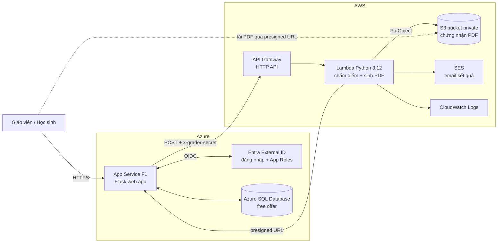

# QuizCloud: Hệ thống khảo sát & thi trắc nghiệm trực tuyến đa đám mây (Azure + AWS)

Giáo viên tạo đề → học sinh làm bài → **AWS Lambda** tự chấm điểm, sinh **chứng nhận PDF** lưu trên **S3** và trả về **presigned URL**.
Tài khoản & phân quyền Giáo viên/Học sinh dùng **Microsoft Entra External ID**, dữ liệu lưu ở **Azure SQL Database**.

## Kiến trúc



**Luồng nộp bài:** Web lưu bài làm vào Azure SQL → gửi đáp án + đáp án đúng sang API Gateway → Lambda chấm, sinh PDF (fpdf2), lưu S3, gửi email (SES), trả về điểm + `certificate_key` + presigned URL → Web ghi điểm vào Azure SQL.
Lambda **không kết nối trực tiếp Azure SQL** (tránh cài ODBC driver trên Lambda và mở firewall SQL cho mọi IP). Mỗi lần mở trang kết quả, web xin presigned URL mới vì URL cũ đã hết hạn.

## Chức năng

| Vai trò | Chức năng |
|---|---|
| Giáo viên | Tạo/xoá bài thi (thời gian, ngưỡng đạt), thêm câu hỏi 1 hoặc nhiều đáp án, nhập câu hỏi từ CSV, mở/đóng bài thi, xem kết quả + thống kê (TB, max, min, tỉ lệ đạt), xuất **CSV**, **báo cáo HTML** in được (tỉ lệ đúng từng câu) |
| Học sinh | Xem bài thi đang mở, làm bài có đồng hồ đếm ngược (tự nộp khi hết giờ), 1 lần nộp, xem kết quả chi tiết từng câu, tải **chứng nhận PDF** (đạt) / **phiếu kết quả PDF** (chưa đạt), nhận email kết quả |
| Hệ thống | Phân quyền theo App Role của Entra, CSRF, chỉ chủ bài/giáo viên xem được bài nộp, chấm lại khi Lambda lỗi |

## Cấu trúc

```
quiz-multicloud/
├── web/        # Flask app → Azure App Service
│   ├── app.py, auth.py (Entra/MSAL), models.py (Azure SQL), grader_client.py, config.py
│   └── templates/
├── grader/     # Code Lambda → AWS
│   ├── handler.py (entry), service.py, grading.py, certificate.py, fonts/ (font Unicode cho tiếng Việt)
│   └── build_zip.sh  # tạo grader.zip để upload
└── tests/
```

## Chạy local (không cần tài khoản cloud)

```bash
cd quiz-multicloud
python3 -m venv .venv && . .venv/bin/activate
pip install -r web/requirements.txt -r grader/requirements.txt pytest boto3
python -m pytest -q tests                 # chạy test

cd web
flask --app app init-db --demo            # tạo bảng + 1 bài thi mẫu (SQLite)
flask --app app run                       # http://localhost:5000
```

Ở local, `AUTH_MODE=dev` cho phép chọn vai trò khi đăng nhập (email `teacher@demo.local` là giáo viên của bài mẫu). Khi `GRADER_URL` để trống, bài được chấm ngay trong app bằng chính code của Lambda và PDF lưu vào `web/instance/certificates/`.

## Deploy

> Dùng **Azure for Students** (không cần thẻ) và tài khoản AWS mới. **Bật Budget Alert (~$1) trên cả 2 cloud** và **xoá tài nguyên sau khi chấm**. Hạn mức free tier có thể thay đổi, kiểm tra trang pricing trước khi tạo.

### AWS (làm trước để có `GRADER_URL`)

1. **S3**: tạo bucket (vd. `quizcloud-certs-<tên-nhóm>`, region `ap-southeast-1`), giữ nguyên *Block all public access*.
2. **IAM role cho Lambda**: policy `AWSLambdaBasicExecutionRole` + inline policy:
   ```json
   {"Version": "2012-10-17", "Statement": [
     {"Effect": "Allow", "Action": ["s3:PutObject", "s3:GetObject"], "Resource": "arn:aws:s3:::<BUCKET>/certificates/*"},
     {"Effect": "Allow", "Action": "ses:SendEmail", "Resource": "*"}]}
   ```
3. **Lambda**: runtime Python 3.12 (x86_64), chọn role trên. Chạy `grader/build_zip.sh` rồi upload `grader.zip`.
   Handler: `handler.lambda_handler`, Memory 512 MB, Timeout 30 s. Biến môi trường:
   `CERT_BUCKET=<bucket>`, `GRADER_SECRET=<chuỗi ngẫu nhiên dài>`, tuỳ chọn `SES_SENDER=<email đã verify>`, `PRESIGN_TTL_SECONDS=3600`.
4. **API Gateway** → *HTTP API* → integration Lambda trên, route `POST /grade`. URL dạng `https://xxxx.execute-api.ap-southeast-1.amazonaws.com/grade` chính là `GRADER_URL`.
5. **SES** (tuỳ chọn): *Verified identities* → verify email gửi và các email nhận (SES sandbox chỉ gửi tới email đã verify, đủ cho demo).
6. Xem log tại **CloudWatch** → Log groups → `/aws/lambda/<tên-hàm>`.

### Azure

1. **Entra External ID**
   - Microsoft Entra admin center → tạo **external tenant**.
   - *App registrations* → New: Redirect URI (Web) `https://<app>.azurewebsites.net/auth/callback`. Tạo **client secret**.
   - *App roles* → tạo 2 role với **Value** `Teacher` và `Student` (Allowed member types: Users).
   - *User flows* → tạo flow đăng ký/đăng nhập (email + mật khẩu), thêm application vào flow.
   - *Enterprise applications* → app → *Users and groups* → gán user vào role Teacher/Student. User chưa có role sẽ thấy trang "chưa được phân quyền".
   - Authority: `https://<tenant-subdomain>.ciamlogin.com/<tenant-subdomain>.onmicrosoft.com`
2. **Azure SQL Database**: khi tạo, chọn **Apply offer** (free serverless database). Ở *Networking* bật *Allow Azure services* và thêm IP máy mình để chạy lệnh tạo bảng.
   Tạo bảng từ máy local:
   ```bash
   cd web
   DATABASE_URL='mssql+pymssql://<user>:<password>@<server>.database.windows.net:1433/<db>' flask --app app init-db --demo
   ```
   (Mật khẩu có ký tự đặc biệt thì URL-encode. Database free tự pause khi rảnh, lần kết nối đầu có thể chậm/lỗi, thử lại sau vài giây.)
3. **App Service** (Linux, Python 3.12, gói **F1 Free**):
   ```bash
   cd web
   az webapp up --name <app> --runtime PYTHON:3.12 --sku F1 --location southeastasia
   az webapp config set --name <app> --resource-group <rg> --startup-file "gunicorn --bind=0.0.0.0 --timeout 120 app:app"
   ```
   *Configuration → Application settings*:

   | Tên | Giá trị |
   |---|---|
   | `SECRET_KEY` | chuỗi ngẫu nhiên |
   | `DATABASE_URL` | như trên |
   | `AUTH_MODE` | `entra` |
   | `ENTRA_CLIENT_ID`, `ENTRA_CLIENT_SECRET`, `ENTRA_AUTHORITY` | từ bước 1 |
   | `GRADER_URL`, `GRADER_SECRET` | từ phần AWS |
   | `SCM_DO_BUILD_DURING_DEPLOYMENT` | `true` |

## Grader API (hợp đồng giữa Azure và AWS)

`POST GRADER_URL` với header `x-grader-secret`:

```json
{"action": "grade", "submission_id": 7,
 "student": {"name": "Nguyễn An", "email": "an@school.edu"},
 "exam": {"id": 3, "title": "Kiểm tra Cloud", "pass_percent": 50},
 "questions": [{"id": 1, "points": 1, "correct": [1]}, {"id": 2, "points": 2, "correct": [0, 2]}],
 "answers": {"1": [1], "2": [0, 2]}}
```
→ `{"score": 3, "max_score": 3, "percent": 100, "passed": true, "details": [...], "certificate_id": "...", "certificate_key": "certificates/...pdf", "certificate_url": "https://...presigned..."}`

`{"action": "presign", "certificate_key": "certificates/..."}` → `{"certificate_url": "..."}`

Quy tắc chấm: câu nhiều đáp án chỉ được điểm khi chọn **đúng và đủ**.

## Danh sách dịch vụ (dùng cho báo cáo)

Azure: Entra External ID, App Service, Azure SQL Database. AWS: API Gateway, Lambda, S3 (presigned URL), SES, CloudWatch, IAM.
